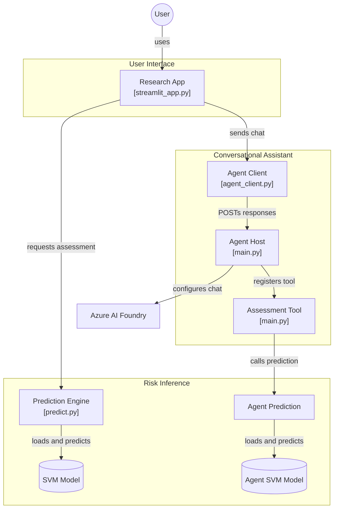
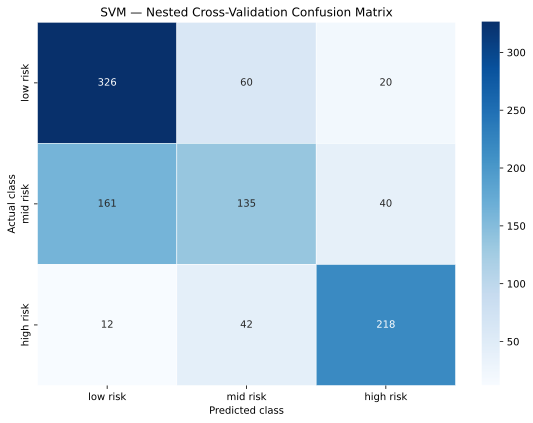
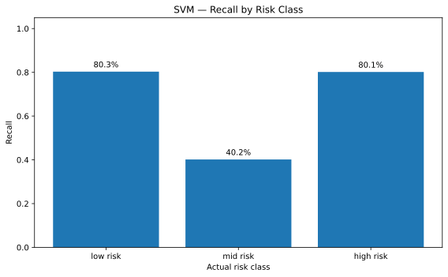
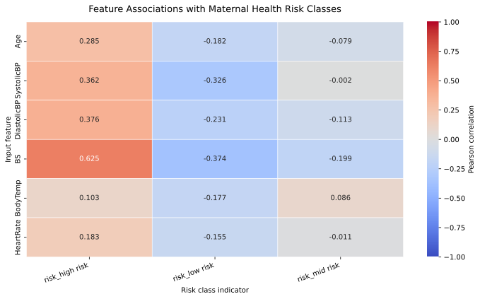
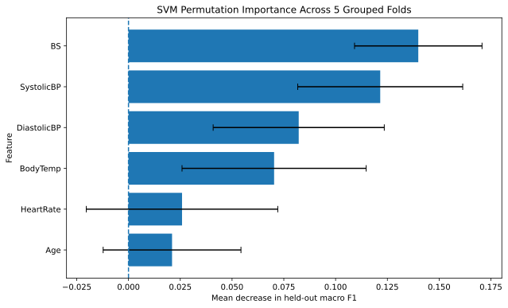

# MaternalRisk AI

An experimental **maternal-health risk classification** project: an SVM model trained on six physiological measurements, a Streamlit research app to try it out, and an Azure-hosted conversational agent that can run the same risk assessment as a tool.

> **Disclaimer:** This is a research and education project built for learning. It is **not** a medical device and must not be used for diagnosis or clinical decisions. Always consult a qualified healthcare professional.

---

## Features

- **Risk prediction:** a Support Vector Machine (SVM) classifier predicts maternal risk level (low / mid / high) from six physiological inputs.
- **Streamlit research app:** enter measurements, get a local prediction, and browse research findings and dataset information.
- **Conversational assistant:** chat with an Azure AI Foundry-backed agent that calls the risk assessment through a registered tool.
- **Rigorous evaluation:** nested cross-validation, class-wise recall analysis, class-weight diagnostics, and permutation importance.

### Feature Importance (Permutation, 5-fold)

Importance is measured as the mean drop in F1 when a feature is shuffled.

| Rank | Feature | Mean F1 decrease | Across-fold SD | Mean within-fold permutation SD |
|---|---|---|---|---|
| 1 | BS (blood sugar) | 0.140 | 0.031 | 0.022 |
| 2 | SystolicBP | 0.122 | 0.040 | 0.022 |
| 3 | DiastolicBP | 0.082 | 0.041 | 0.023 |
| 4 | BodyTemp | 0.070 | 0.044 | 0.020 |
| 5 | HeartRate | 0.026 | 0.046 | 0.013 |
| 6 | Age | 0.021 | 0.033 | 0.008 |

**Key takeaway:** blood sugar and systolic blood pressure matter most. For HeartRate and Age, the across-fold SD is larger than the mean F1 decrease, so their contribution is small and not stable across folds.

---

## Architecture



Interactive version: [GitDiagram](https://gitdiagram.com/shub1504/ml_project)

**How it flows**

1. The user opens the Streamlit app and enters six measurements.
2. `src/predict.py` loads the trained SVM (`models/maternal_risk_model.joblib`) and returns a risk class.
3. For chat, the app sends messages through `src/agent_client.py` to the agent host, which uses Azure AI Foundry and exposes the risk assessment as a tool backed by its own copy of the model.

---

## Project Structure

```
ML_project/
├── app/                 # Streamlit research app (streamlit_app.py)
├── src/                 # Prediction engine and agent client
├── models/              # Trained SVM (joblib) + model metadata
├── agent/               # Agent-related files
├── agent-framework-agent-with-local-tools-responses/
│                        # Azure-hosted agent with the local assessment tool
├── assets/
│   ├── dashboards/      # Analysis dashboards (PNG)
│   ├── results/         # Metrics and result tables (CSV, TXT)
│   └── visualizations/  # Charts (SVG)
├── ML_project.ipynb     # Training and analysis notebook
├── test_integration.py  # Integration tests
├── azure.yaml           # Azure deployment config
├── requirements.txt
├── .env.example         # Template for environment variables
└── README.md
```

---

## Research Results

Evaluation was done with **nested cross-validation** to avoid optimistic bias, with extra diagnostics on the harder classes.

| Analysis | Output |
|---|---|
| Overall and class-wise metrics | `assets/results/maternalrisk_overall_results.csv`, `maternalrisk_classwise_results.csv` |
| Nested CV and per-fold performance | `maternalrisk_nested_cv_results.csv`, `maternalrisk_fold_performance.csv` |
| Error summary | `maternalrisk_svm_error_summary.csv` |
| Permutation importance (5-fold) | `maternalrisk_svm_permutation_importance_5fold.csv` / `.svg` |
| Research notes | `maternalrisk_research_notes.txt` |

### Dashboards

| | |
|---|---|
|  |  |
|  |  |
|  | |

### Visualizations

- Confusion matrix: `assets/visualizations/maternalrisk_svm_confusion_matrix.svg`


- Class-wise recall: `assets/visualizations/maternalrisk_svm_class_recall.svg`


### Class-wise Results

Two strategies compared: a fixed unweighted SVM, and an SVM whose class weight was selected by inner cross-validation.

| Strategy | Risk class | Precision | Recall | F1 score | Support |
|---|---|---|---|---|---|
| Fixed unweighted SVM | Low risk | 0.655 | 0.842 | 0.737 | 406 |
| Fixed unweighted SVM | Mid risk | 0.594 | 0.396 | 0.475 | 336 |
| Fixed unweighted SVM | High risk | 0.813 | 0.801 | 0.807 | 272 |
| Inner-CV-selected class weight | Low risk | 0.655 | 0.842 | 0.737 | 406 |
| Inner-CV-selected class weight | Mid risk | 0.592 | 0.420 | 0.491 | 336 |
| Inner-CV-selected class weight | High risk | 0.835 | 0.779 | 0.806 | 272 |

**Key takeaway:** mid-risk is the hardest class. Class weighting lifts its recall (0.396 → 0.420) and F1 (0.475 → 0.491), at a small cost to high-risk recall.

- Feature vs. class correlation: `assets/visualizations/maternalrisk_feature_class_correlation.svg`


- Permutation importance: `assets/visualizations/maternalrisk_svm_permutation_importance_5fold.svg`


---

### Overall Results

| Strategy | Accuracy | Macro precision | Macro recall (balanced acc.) | Macro F1 |
|---|---|---|---|---|
| Fixed unweighted SVM | 0.683 | 0.687 | 0.680 | 0.673 |
| Inner-CV-selected class weight | 0.685 | 0.694 | 0.680 | 0.678 |

Metrics are computed with nested cross-validation. Class weighting gives only a modest gain overall (+0.2 pts accuracy, +0.5 pts macro F1), so the main limitation remains the mid-risk class.

## Getting Started

### Prerequisites

- Python 3.10+
- An Azure AI Foundry project (only needed for the chat assistant)

### Installation

```bash
git clone https://github.com/shub1504/ML_project.git
cd ML_project

python -m venv .venv
# Windows
.venv\Scripts\activate
# macOS / Linux
source .venv/bin/activate

pip install -r requirements.txt
```

### Configuration

```bash
cp .env.example .env      # Windows PowerShell: Copy-Item .env.example .env
```

Fill in the values in `.env`. This file is git-ignored; **never commit real keys or endpoints.**

### Run the app

```bash
streamlit run app/streamlit_app.py
```

### Run the tests

```bash
python test_integration.py
```

---

## Tech Stack

Python, scikit-learn (SVM), Streamlit, Jupyter, Azure AI Foundry (agent framework), joblib.

---

## Limitations

- Trained on a small public-style tabular dataset; results may not generalize to real clinical populations.
- The mid-risk class is the hardest to separate (see the class-weight and mid-risk dashboards).
- Predictions are for demonstration only and carry no clinical validation.

---

## Author

**Shub**, B.Sc. (Hons.) Computer Science, Ramanujan College, University of Delhi.
GitHub: [@shub1504](https://github.com/shub1504)
